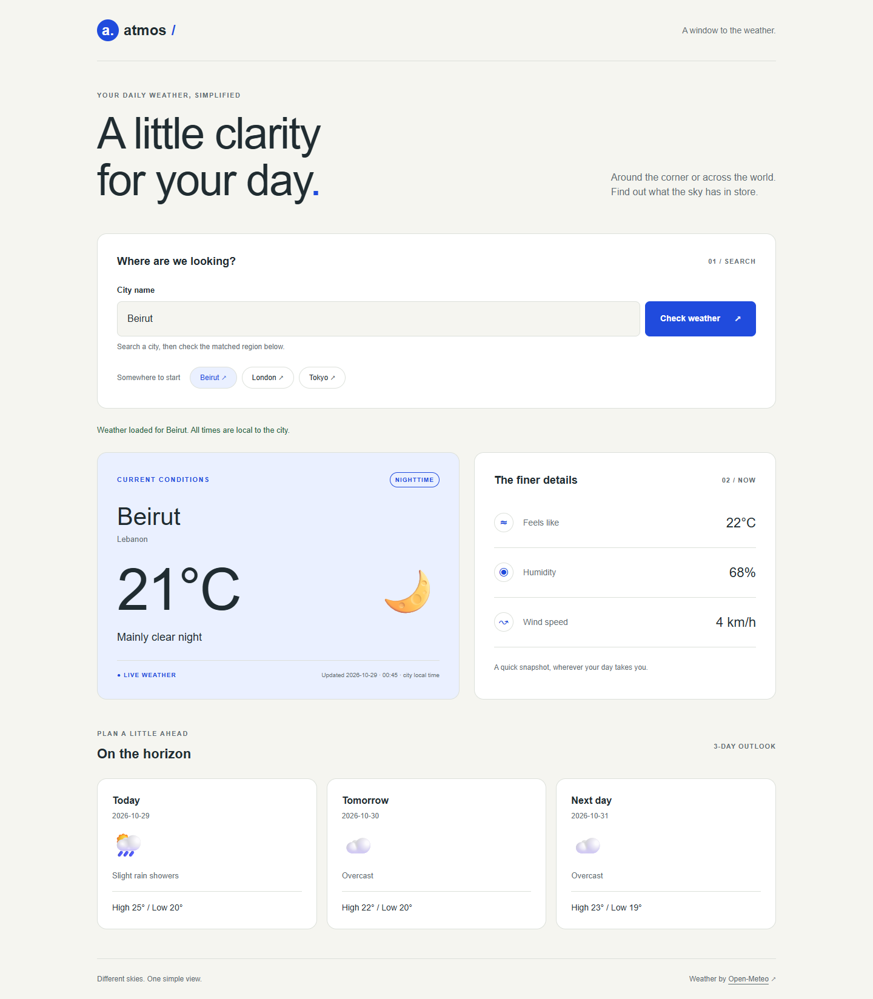

# Atmos | React Weather Dashboard

Assignment 5: the original Atmos Weather Dashboard rebuilt with **React and Vite**, using the functional components, JSX, props, state, controlled forms, and effects covered in Sessions 13–15.

## Install and run

Use Node.js **22.12 or newer** (Node 24 recommended), npm, a modern browser, and an internet connection for live weather.

```bash
git clone https://github.com/JovaniBouKhalil/react-weather-app.git
cd react-weather-app
npm install
npm run dev
```

Open the local URL printed by Vite (normally `http://localhost:5173`). For the submitted ZIP, extract it, open a terminal in the extracted project folder containing `package.json`, and run the same install and dev commands. No API key, account, or `.env` file is needed.

```bash
npm run build     # Create the production app in dist/
npm run preview   # Serve that production build locally
npm run lint      # Check JavaScript, JSX, and hook dependencies
```

## Using the dashboard

Enter a city and press Enter or **Check weather**, or choose Beirut, London, or Tokyo. Check the matched region/country because cities can share a name. Results show current temperature, conditions, day/night, feels-like temperature, humidity, wind speed, and a three-day forecast. Temperatures use Celsius and wind speed uses km/h. Observation times and forecast dates belong to the searched city.

The form rejects blank, whitespace-only, and one-character searches before fetching. Loading feedback appears and search controls are disabled during requests. Unknown cities, failed connections, rate limits, server failures, and incomplete data produce readable errors and a **Try again** button. A 15-second timeout restores the controls if a request stalls.

## Components and data flow

Each component lives in its own file; all are functional components.

```text
App
├── Header
├── SearchBar              Controlled city input, validation, quick searches
├── LoadingSpinner         Loading feedback for the submitted city
├── ErrorMessage           Error text and retry callback
├── EmptyState             Guidance before results exist
├── WeatherCard            Current conditions and matched location
├── WeatherDetails         Feels like, humidity, and wind
├── Forecast               Maps the three forecast days
│   └── ForecastCard       Reusable card with a stable date key
└── Footer
```

**State ownership (Sessions 14–15).** `SearchBar` owns `query` and `validationError` with `useState`, because only the form needs the draft text. `App` owns the submitted `request`, fetched `weather`, request `status`, and API `error` with `useState`, because sibling components need those values. `loading` and display values are derived rather than stored as duplicate state. Typing only updates the draft; a valid form submission calls the parent's `onSearch` callback.

**Props and communication (Sessions 13–15).** `App → SearchBar` passes `onSearch` and `loading`; `App → WeatherCard` passes `location` and `current`; `App → ErrorMessage` passes a message and retry callback. `Forecast → ForecastCard` passes the individual day's values. Data flows down and callbacks send actions up. Props travel at most two component levels (`App → Forecast → ForecastCard`), so no deeper prop drilling or Context is necessary.

**Effect and fetching (Session 15).** `App`'s `useEffect` depends on `[request]`. An idle app does not fetch, and editing the draft does not fetch. Each submission creates a new request object, so submitting the same city or retrying still works. The effect calls an inner async function, awaits the API helper, and catches failures. Its cleanup clears the timer, aborts in-flight fetches, and marks the effect inactive, preventing abandoned responses from changing state after cleanup. This also handles development StrictMode's extra effect setup/cleanup. The timeout uses the same protection.

**Conditional UI (Session 14).** The request status selects idle, loading, error, or success JSX. React renders API text safely through expressions; the app has no manual DOM rendering or `innerHTML`. Forecast cards use `.map()` and the API date as their key.

## API and original project

`src/services/weather.js` first calls the [Open-Meteo Geocoding API](https://open-meteo.com/en/docs/geocoding-api) to get a city's coordinates, then the [Open-Meteo Forecast API](https://open-meteo.com/en/docs) for current conditions and three days. HTTP status codes and required response fields are checked before displaying results. `src/utils/conditions.js` translates WMO codes into descriptions and icons; actual weather measurements always come from the API.

The responsive CSS, favicon, weather-code mapping, and API validation were adapted from the original Assignment 4 dashboard supplied in this workspace. The React project runs directly from this repository's root. The original local `weather-dashboard-main/` folder is preserved as a reference and excluded from Git and the submission ZIP; its old DOM scripts are not used by the React app.

```text
src/
├── main.jsx               React root and StrictMode
├── App.jsx                Shared state, effect, and page composition
├── styles.css             Original responsive design plus form error styles
├── components/            One component per file
├── services/weather.js    Fetching, validation, and friendly API errors
└── utils/conditions.js    Weather-code descriptions and icons
public/favicon.png
tests/weather.spec.js      Browser behavior checks with controlled API responses
```

## Browser checks

```bash
npx playwright install chromium
npm test
```

The tests start Vite automatically and cover input validation, Enter submission, quick searches, current data and forecast replacement, loading controls, same-city retry, network/HTTP/incomplete-data failures, timeout recovery, and overflow at 320, 390, 768, and 1440 pixels. Mock responses make these checks repeatable; normal app use always calls the live APIs.

Development verification: all **13 browser checks**, lint, and the production build passed. The browser checks ran using installed Google Chrome via `PLAYWRIGHT_CHROMIUM_CHANNEL=chrome`; the default command above uses Playwright's downloaded Chromium. Live API requests for Beirut, London, and Tokyo also succeeded, and a live Beirut browser search produced no uncaught errors.

## Screenshots

Captured from the React app using a live Beirut search. These are examples; the app requests fresh data when you search.



[Mobile results](screenshots/beirut-mobile.png) · [Initial search screen](screenshots/desktop-search.png)

## Rubric coverage

| Criterion | Points | Implementation |
| --- | ---: | --- |
| Component architecture | 25 | Focused components in separate files; reusable forecast cards |
| State management | 20 | Local draft/validation; shared request, data, status, and error state |
| useEffect / fetching | 20 | Submitted-request dependency, async try/catch, abort and timer cleanup |
| Props / communication | 15 | Multiple parent/child pairs, callbacks, maximum two-level flow |
| UI / responsiveness | 10 | Original responsive design, accessible feedback, validation, retry |
| Code quality | 10 | Organized source, session-style comments, lint, no starter boilerplate |

## Submission

Submit the [GitHub repository](https://github.com/JovaniBouKhalil/react-weather-app) and the accompanying `react-weather-app-submission.zip`. The ZIP contains the React source, dependency lockfile, README, checks, and screenshots, with no `node_modules`, build output, credentials, or Git history.

If a city cannot be found, check its spelling or try a nearby city. For a network error or timeout, check the connection and retry. For rate limits, wait a minute. If the default dev-server port is occupied, use the alternative URL printed by Vite.
